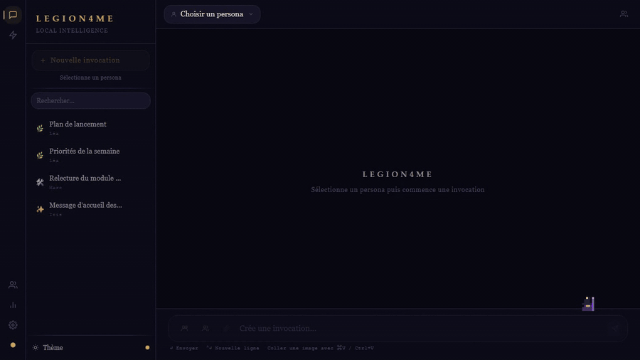

# Legion4me

[Version française](README.fr.md)

Legion4me is a personal AI assistant that runs entirely on your own machine. You configure personas, on-demand agents and a persistent memory on top of local models served by Ollama. The backend is written in Node and TypeScript, the interface in Vue 3, and everything is stored in a local SQLite database.

No data leaves your computer, except the calls you explicitly allow through the tools (web search, Gmail, weather). The models run on your own graphics card.

## Features

- A persona is an Ollama model with a system prompt, a temperature, a name and a color. Each conversation belongs to one persona, so switching persona changes the model that answers and what it remembers about you.
- The council and salon modes put several personas in the same conversation. Each speaker receives a memory context of its own.
- The memory is extracted after each exchange by the model. A second call decides whether a fact is global or tied to a persona. The memory block injected in the prompt has a different shape in a one to one chat, in a council and in a salon.
- Long conversations are compacted by steps. Once more than ten messages are not covered, the six oldest are merged into a running summary stored per conversation, and the chat never blocks if the summary fails.
- Five agent types can be launched on demand: email digest, morning briefing, topic watch, meeting summary and weekly review. Their prompts force the model to use only the provided sources and to cite them.
- Gmail is connected through read only OAuth2. The client credentials are entered in the settings screen and stored in the database, not in code or in the environment file.
- The chat can call tools for web search, page fetching, Wikipedia, YouTube transcripts, date and time, and saving a memory.
- You can attach images and files. Text PDFs are extracted, and scanned PDFs can be sent to vision models once poppler is installed.
- A statistics screen shows the tokens read and generated per persona, taken from the counts Ollama returns.
- Several visual themes are available.

## Demo



The [MP4 version](docs/media/demo.mp4) of the demo is also available. It uses fictional data only. The personas, conversations and memories were invented for the recording, and the replies come from a stand-in for Ollama that returns a fixed text, so no real account, no real conversation and no real model appear in it.

## Architecture

The repository is an npm workspace with two packages.

- The backend is an Express server in TypeScript. It stores data in SQLite through Drizzle ORM and better-sqlite3, talks to Ollama over HTTP, and streams chat answers to the browser as server sent events. In production it also serves the built frontend.
- The frontend is a Vue 3 single page application built with Vite, with Pinia stores and Vue Router. In development, Vite proxies the `/api` routes to the backend.
- Ollama runs outside the project and serves the models. On WSL2 the backend detects the Windows gateway address on its own.
- Tavily, Open-Meteo and the Gmail API are only called when you use the matching tool or agent.

## Requirements

- Node.js 20.3 or later, because the backend relies on `AbortSignal.any`.
- Build tools for the native `better-sqlite3` module. On Linux or WSL2 install them with `sudo apt-get install build-essential python3`, and on macOS with `xcode-select --install`.
- [Ollama](https://ollama.com) running and reachable. On WSL2, install it on Windows rather than inside WSL.
- At least one pulled model. The default model for agents without a persona is `qwen3.5:9b`, and `llava:7b` is useful for images.
- Optional. `poppler-utils` for scanned PDFs, and a Tavily API key for web search.

## Installation and launch

```bash
git clone https://github.com/MehdiZen/legion4me.git
cd legion4me
cp backend/.env.example backend/.env
npm install
ollama pull qwen3.5:9b
npm run dev
```

The interface opens on http://localhost:5173 and the API listens on http://localhost:3001. The SQLite database is created at the first start.

For a production style run, build the project and start the backend, which then serves the interface on port 3001.

```bash
npm run build
npm start
```

The repository also ships an `ecosystem.config.js` file for PM2, which starts `backend/dist/index.js` and reads `backend/.env`. Run `pm2 start ecosystem.config.js` after a build. The detailed setup guide, written in French, is in [SETUP.md](SETUP.md).

## Configuration

The backend reads its settings from `backend/.env`. Copy `backend/.env.example` and adjust the values. The values below are placeholders.

| Variable | Default | Role |
|---|---|---|
| `PORT` | `3001` | Port of the backend |
| `FRONTEND_URL` | `http://localhost:5173` | Origin allowed by CORS |
| `OLLAMA_URL` | detected | Base URL of Ollama, for example `http://localhost:11434` |
| `OLLAMA_HOST` | unset | Host and port of Ollama, used when `OLLAMA_URL` is not set |
| `DB_PATH` | `./legion4me.db` | Path of the SQLite file, relative to the working directory of the process |
| `TAVILY_API_KEY` | unset | Enables web search, for example `tvly-xxxxxxxx` |
| `GMAIL_REDIRECT_URI` | `http://localhost:3001/api/gmail/callback` | OAuth callback used by the Gmail integration |

The Google OAuth client id and secret are not environment variables. They are entered in the settings screen of the application.

## Development

- `npm run dev` starts the backend with `tsx watch` and the frontend with Vite, side by side.
- `npm run build` compiles the backend with `tsc` and builds the frontend after a `vue-tsc` type check.
- `npm start` runs the compiled backend.
- The project has no automated tests and no linter configured yet. A quick type check of the backend is `npx tsc --noEmit -p backend`, and `npx vue-tsc --noEmit` does the same for the frontend from the `frontend` folder.

## Repository structure

```text
backend/
  src/
    index.ts          Express app and route mounting
    db/               SQLite client and Drizzle schema
    routes/           REST and streaming routes
    services/         Ollama client, agents, memory, summaries, tools, files
      orchestrator/   Chat, council and salon logic, prompts and context
frontend/
  src/
    views/            Chat, agents, personas, statistics, settings
    components/       Interface components
    stores/           Pinia stores
    themes/           Visual themes
docs/media/           Demo video and GIF
ecosystem.config.js   PM2 configuration
SETUP.md              Detailed setup guide (French)
```

## License

Copyright (c) 2026 Mehdi Zenati. Legion4me is **source-available** under a dual license. It is free for personal non-commercial use, and a paid license is required for commercial and professional use. See [LICENSE](LICENSE) for the exact terms. Third-party libraries keep their own licenses.
